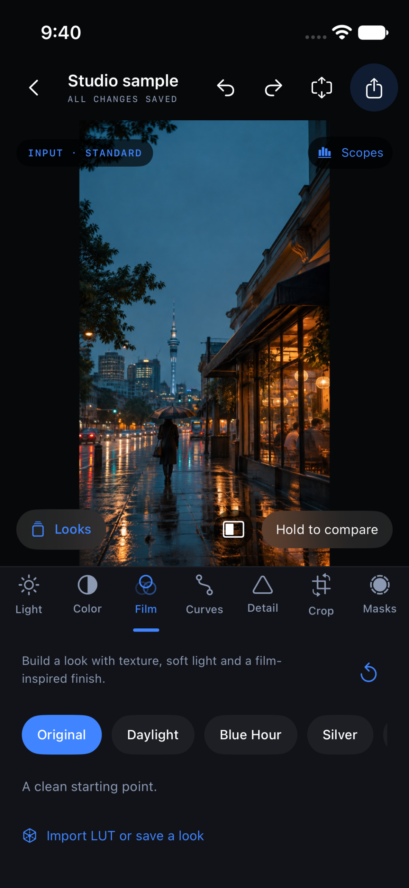
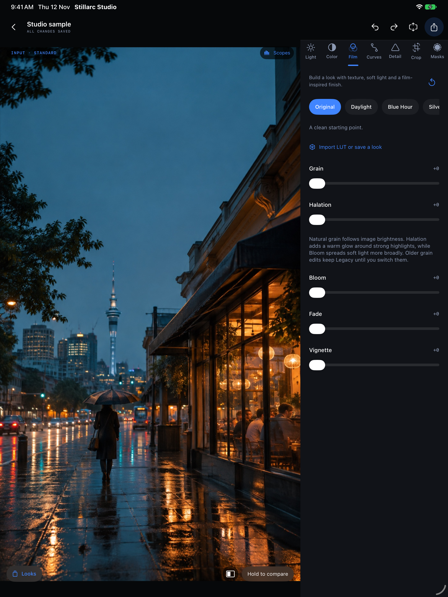
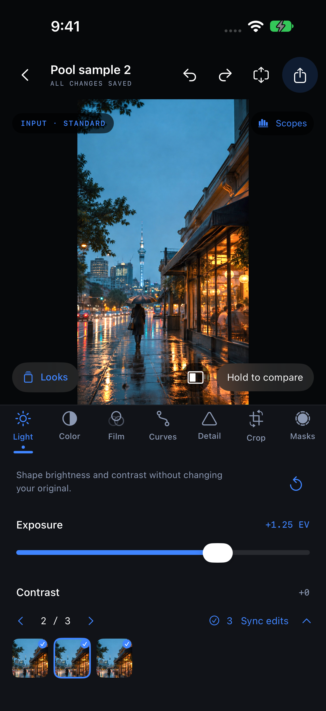

# Stillarc Studio · 0.32

A local, reversible photo and single-clip video editor for iPhone and iPad. Black-and-blue controls keep the image central.

Develop light and color with Levels, RGB curves, selective color, wheels and channel mixing. Convert supported Log sources before grading; import creative LUTs or save reusable Studio presets. Make targeted changes with gradients, brushes, color/brightness ranges and on-demand subject/sky selections. Position tracking follows a region through a short clip.

Natural grain gives an image fine texture; Halation adds warmth around bright edges; Bloom softens bright areas. Manual lens distortion correction helps straighten bowed lines. Each can be undone, reset or left off.

Trim video and export HEVC SDR or 10-bit HLG HDR, with explicit metadata/privacy choices. Photos export at full remaining source resolution as SDR JPEG/PNG or 10-bit HLG HEIF. Originals stay untouched. Favorites, ratings, batch actions, saved versions and Recently Deleted help organize local work.

 

These are actual app UI screenshots using an owned illustrative sample, not camera-output claims. No timeline editing or unvalidated third-party camera-profile database is advertised. Supported RAW lens correction uses Apple’s decoder. Public distribution is not yet available; see the release checklist.

Edit a set in one place: select projects and open an editing pool, browse with a filmstrip, then synchronize chosen color settings across selected items or the whole pool. Refine each image independently afterward. Resume the pool later without duplicating originals.

Subject & Background creates two editable regions with one on-device analysis. Brighten a person while separately dimming or desaturating their surroundings. The red Guide is only a selection overlay. Paired controls edit the two regions separately. Remove background now creates a reversible photo cutout; full-size PNG export preserves transparency.

Pool sync now has grouped Undo/Redo across the changed items, alongside individual edits. Photo cutouts reuse saved selections and show a checkerboard preview, with edge refinement and alpha-preserving PNG export. Changing-pose video matting remains future work.

Replace a photo background with a color, your own image or a softened original scene. Move, scale, blur and grade the replacement separately. Duplicate/invert selections and adjust local tint, highlights, shadows, clarity and blur without repeating analysis. Existing saved-matte edge controls and brushes refine the boundary.

Develop supported RAW photos with native white balance, exposure, boost and available recovery/noise/lens switches. Reduce color fringing with manual optics controls. Heal/Clone repairs small spots from a clean source patch; full-resolution detail inspection loads a movable tile only when requested. HDR still development preserves available bright detail, while SDR proof shows the JPEG/PNG rendering. HLG HEIF exports require compatible HDR viewers for their full brightness.

Pool delivery now offers Export all or an individual selection. Each item retains its own framing, source settings and repairs. Matching blue arc/S light and dark app icons follow the Home Screen’s supported appearance.

Reference & Match puts a saved visual target beside the current edit. A requested statistical suggestion offers a bounded light/color starting point, with adjustable strength and Undo/Redo. Video uses its first kept frame; HDR is compared as an SDR proof. References remain individual while color corrections can transfer across a pool. The optional vectorscope skin-hue guide gives a visual direction, not a prescribed skin color. Empty Bin is available in Recently Deleted and from its Home long-press menu, with permanent-delete confirmation.
