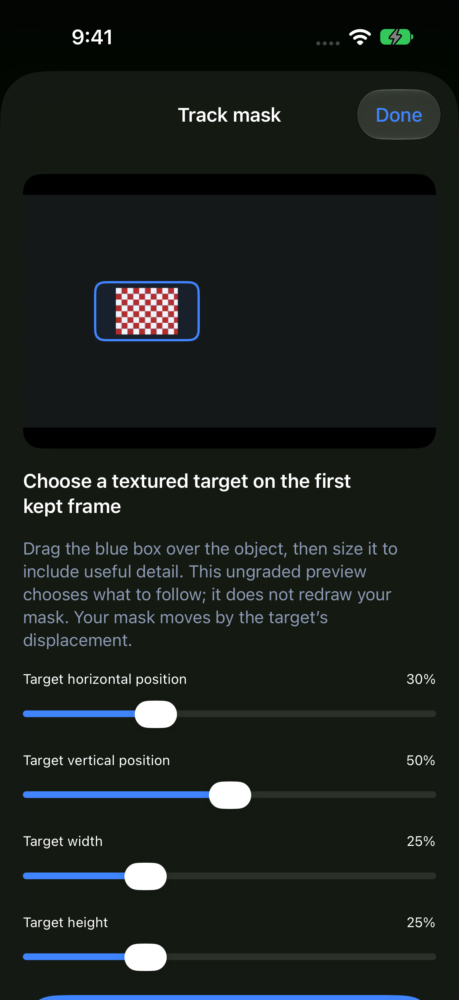

# Video mask tracking — 0.15.0 (16)

Tested on the physical iPhone 17 Pro (Orange) and iPhone 18 Pro simulator. Full native/simulator photo, video and mask interaction suites passed. Actual moving-target fixtures verify portrait/landscape orientation, normalized motion, encoded movement of the local adjustment, exactly 60 media frames per clip and unchanged export dimensions/timing. Tracking cancellation, saved motion, legacy defaults, invalid data, crop/trim invalidation and clear-track Undo/Redo also passed. Native input checks include a bounded tracking preview from a 4K Apple Log 2 source; this is not a full 4K tracked-footage quality certification.

The chosen Vision fast tracking backend passed both portrait-first and landscape-first native fixture orders. Maximum final-target L1 error (normalized horizontal plus vertical error) was 0.00515, under 0.6% of the normalized frame. These are synthetic textured targets, not a guarantee for occlusion, low texture, rapid motion, deformation or arbitrary real-world subjects. The initial accurate backend stalled in a native portrait test; that path is not used in this release.

The three actual-touch XCTest cases passed with the shipping backend: shared slider double-tap/drag, actual editor reset/Undo, and the tracking sheet’s target drag/reset, analysis and clear action. The inspected screenshot below uses a generated test target. The native rendered-mask interaction check passed 180 updates with zero new players; maximum main-actor interval was 41.58 ms, including the requested 16 ms sleep.

The sustained saved-track playback check passed 7,200 requested updates over 129.7 seconds, with four masks, combinations, HDR 1080p playback, a 65-point LUT, scopes, guide, split comparison and simultaneous synthetic brush changes. There were 6,394 render completions, 3,674 decoded frames, zero GPU failures, zero idle frames and no scope jobs after hiding scopes. GPU submission-to-completion p95 was 18.76 ms. Requests are coalesced; these counts are not presentation frame rate or touch-to-display latency. No Vision analysis runs in this playback test: it exercises interpolation of saved motion, as production playback does.

Thermal state was nominal (0) at both endpoints. No physical temperature sensor or battery-energy benchmark was captured. This does not guarantee zero heat, all-day efficiency, or equivalent behavior on every device/source. Analysis handles one reduced-size frame at a time, yields between samples, slows at fair thermal pressure and stops at serious pressure. Live previews are bounded; exports retain source resolution.

A Debug-only export-frame-count test initially attached a track from a different asset instance, causing an AVFoundation exception on device. The harness now uses one asset and counts actual media samples, excluding codec marker buffers. Current full suites pass. Debug progress/launch files and test screens are excluded from normal Release. The signed Release archive passed strict code-signature verification.

Position tracking supports Radial/Brush masks for kept clips up to two minutes. It uses the first kept frame as its reference and interpolates at decoded/source timestamps. Positions hold at the first/last analyzed point outside the sampled interval. No scale/rotation/deformation tracking, AI segmentation, manual motion-keyframe editing, recovery after loss or background analysis is claimed. Tracked brushes cannot be repainted until tracking is cleared. Shorter trims inside the analyzed interval remain valid; framing changes or extended trims require reanalysis/clearing before export. Required parent-mask tracks are checked too.

Implementation references: [Apple tracking requests](https://developer.apple.com/documentation/vision/vntrackingrequest) and [AVAssetReaderTrackOutput](https://developer.apple.com/documentation/avfoundation/avassetreadertrackoutput).

