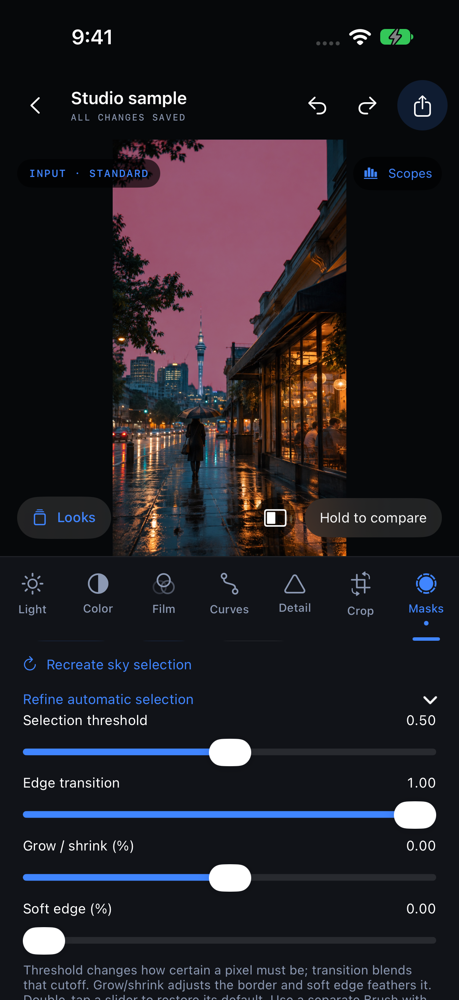

# Subject and sky selection — 0.16.0 (17)

Native iPhone 17 Pro and simulator regression suites passed for automatic-matte orientation, 16-bit soft-probability round-trip, feather/grow refinement, saved recipes, preset/copy isolation, first-frame/crop invalidation, stale inverted-mask safety, empty-selection rejection, saved Subject translation and PNG export/original preservation. Encoded video checks verify saved automatic coverage, guide exclusion and unchanged source frame count. Existing grading, Log/HDR, trim/audio, brush, range, combination and tracking regressions also pass.

Actual bundled-model sky inference passed on the simulator and physical device. Foreground Subject inference is tested natively, not simulated. On the illustrative sample, selected sky/person test points were 1 and excluded street/sky points were 0. Final targeted native timings, after input preparation, were about 0.85 seconds for sky analysis/storage and 0.16 seconds for subject analysis/storage. These are single-sample measurements with potentially warm system caches, not a cold-start or broad accuracy benchmark.

Four actual-touch XCTest cases passed: shared slider double-tap/drag, editor reset/Undo, tracking target/analyze/clear, and automatic Sky creation/refinement/reset plus canceling a Subject sheet without inserting a mask. A focused repeat on a neutral sample also passed and supplied the screenshot. The native preview controller check verifies automatic-mask creation pauses and rewinds video to its first kept frame. Crop changes or a different kept-clip start require selection regeneration before export.

The sustained saved-mask playback check passed 7,200 requested edits over 128.97 seconds with four masks, an automatic matte/refinement, tracked brush, combinations, HDR 1080p playback, a LUT, scopes, guide and split comparison. There were 7,483 render completions and 3,679 decoded frames, zero GPU errors, zero idle frames, no scope work after hiding scopes, and exactly zero analysis calls during playback. GPU submission-to-completion p95 was 14.27 ms. Preview requests are coalesced; these counts are not measured presentation frame rate or touch-to-display latency.

Thermal state was nominal (0) at both endpoints. No physical temperature or battery-energy benchmark was captured. These generated playback fixtures do not establish zero heat or all-day performance on every device, RAW source or real-world video. The final empty-result/preview-retry and explicit reference-frame safeguards were checked separately; the cached-matte render path used by this sustained run was unchanged.

The normal signed Release archive passed compilation and strict signature verification. Its compiled sky model and MIT notice were confirmed in the app bundle. Debug diagnostics/test screens do not run in Release. Model provenance and payload hashes are in [MODELS.md](../../MODELS.md). The [gesture harness](../../../Tests/SliderGestureQA/README.md) is simulator-only; native model and export checks use isolated temporary files and do not change Photos.

Scope: foreground subjects may include several objects; masks are estimates with finite stored resolution (Subject up to 1024 long edge, Sky 384×384). Video masks are generated once from the first kept frame. Subject can follow saved positional motion but does not change shape with a pose. Sky is static. Neither model runs continuously during preview/export. No per-frame semantic video segmentation, AI sky replacement, hair-accuracy guarantee or broad scene-dataset evaluation is claimed. Review the red guide; combine with Brush/range masks for manual corrections.

