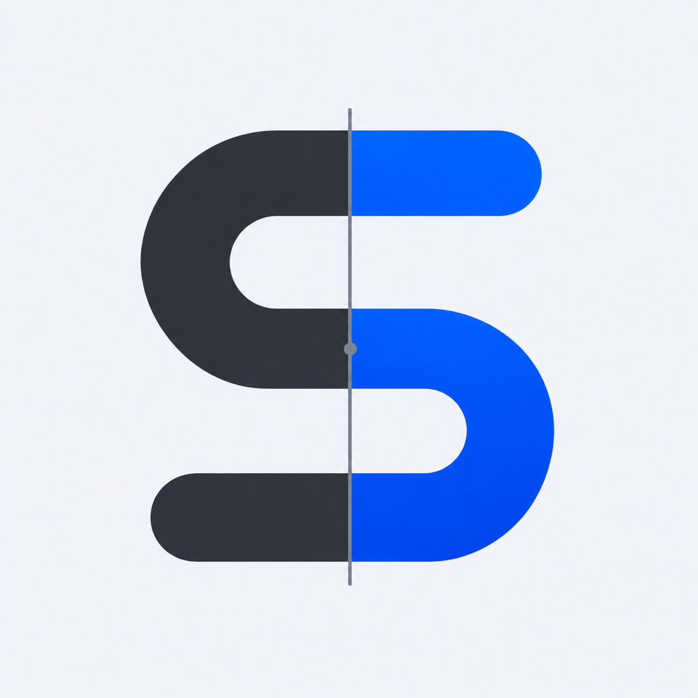
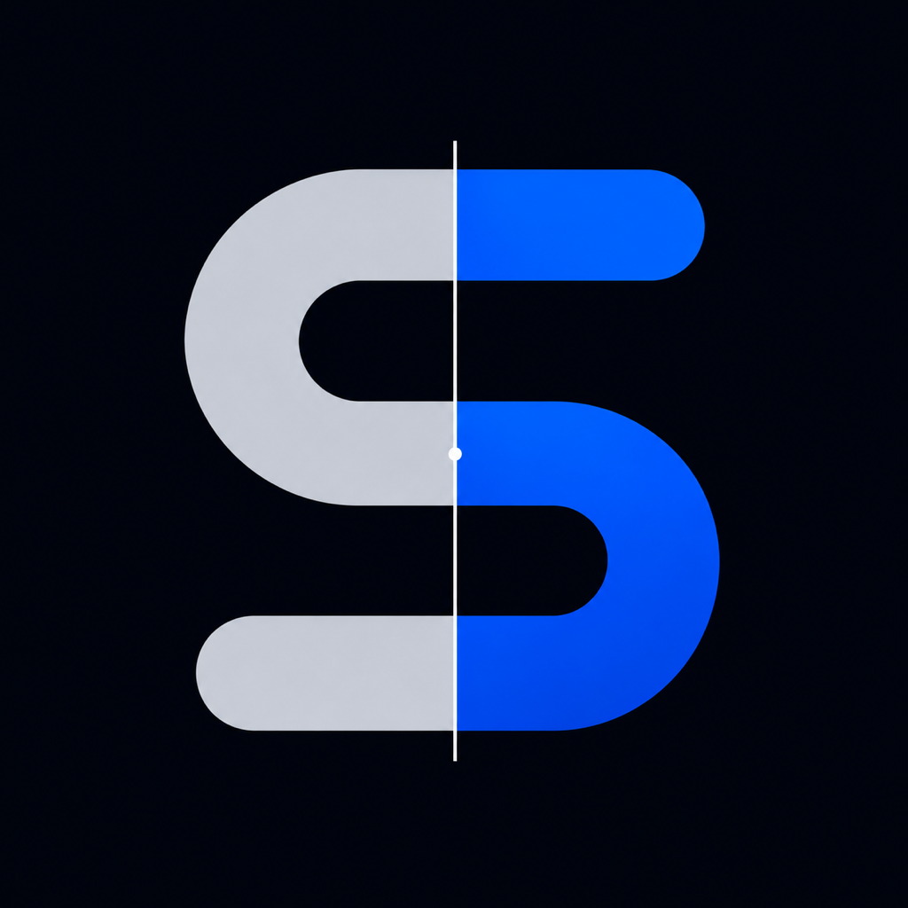
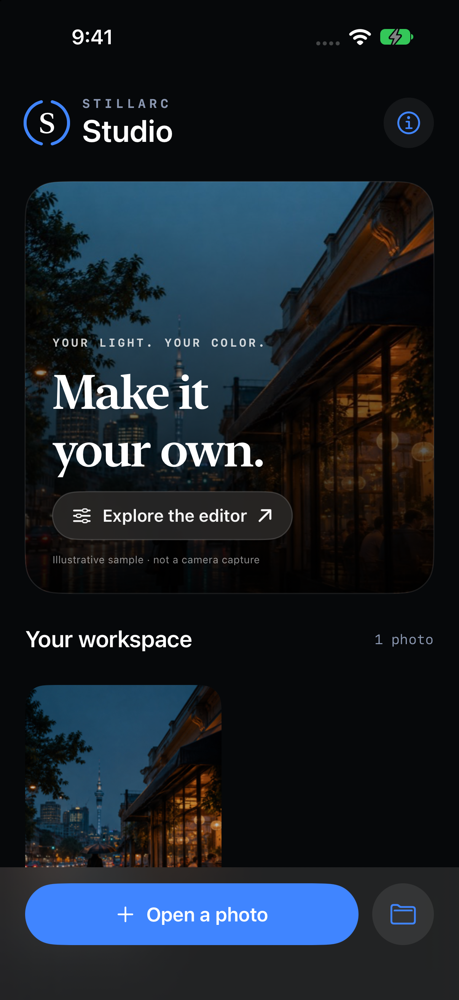
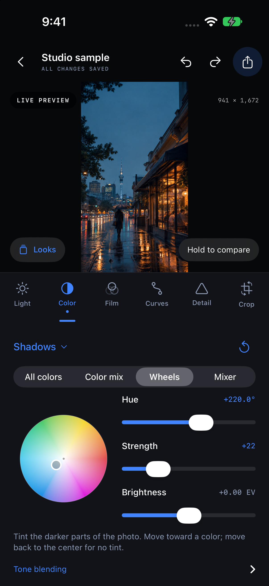
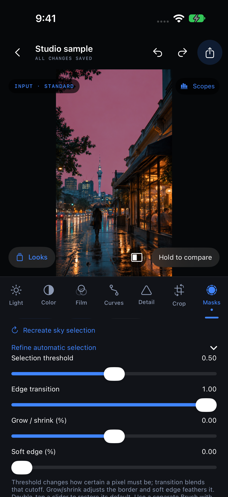
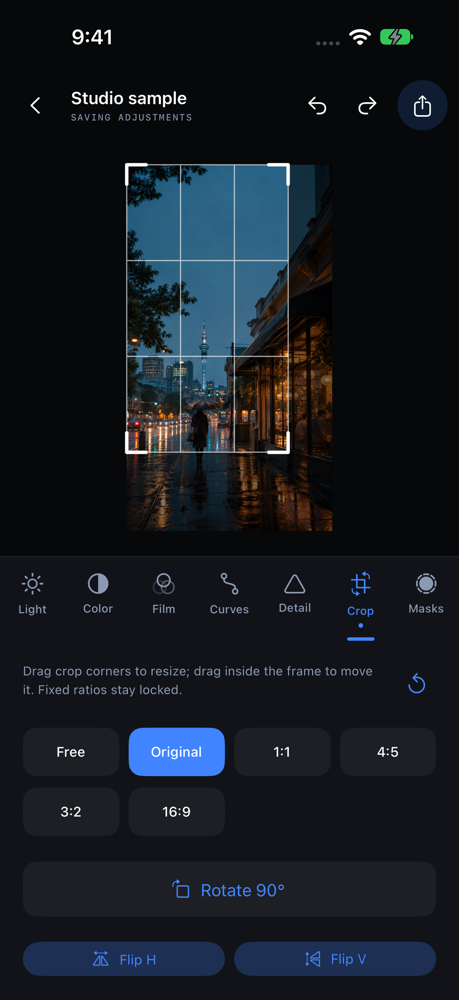
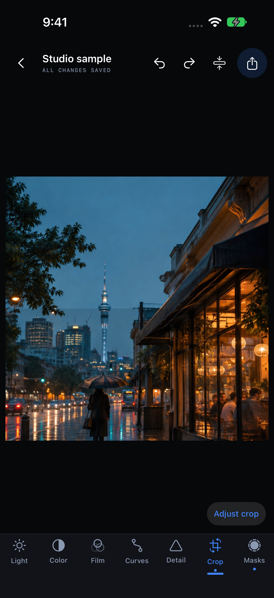
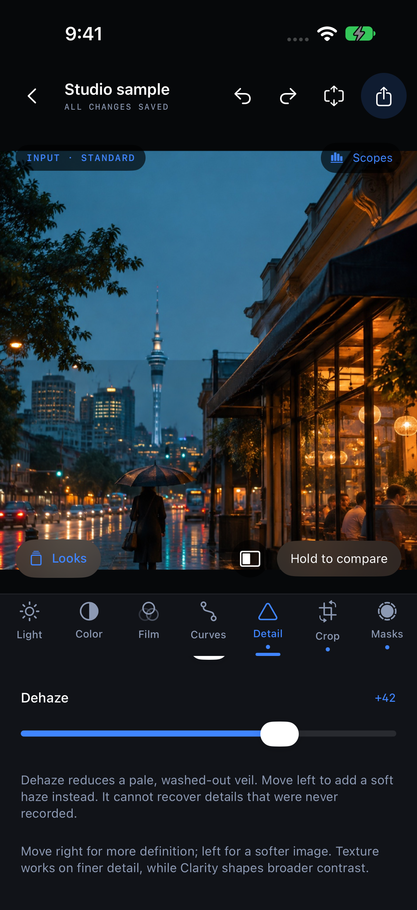

# Stillarc Studio

## Delivery batch · 0.42

Choose **H.264 MP4** for broad SDR playback, **HEVC** for smaller files, or **10-bit ProRes 422 MOV** on supported hardware for further editing. Format choices are remembered and work in single, pool and queued delivery. HDR stays explicit; selecting H.264 never silently strips HDR. [Formats, sound and compatibility](Docs/DELIVERY-042.md).

## Colour batch · 0.41

Convert Canon Log 3 (Rec.2020), Nikon N-Log, Fujifilm F-Log2 and DJI X9 D-Log using explicit gamma/gamut choices. Combine up to three creative LUTs with individual strengths, bypass and ordering. Shape Master/RGB curves with up to twelve movable points per channel; scroll safely with editing locked. These edits save, sync, undo and export together. [Usage, exact profile pairings and technical sources](Docs/COLOUR-041.md).


 

**Your light. Your color.** A native photo and single-clip video editor for iPhone and iPad, with a black-and-blue interface and reversible, local edits.

This is the **0.42 video delivery milestone**. Development is ongoing. The long-term scope is in [the roadmap](Docs/ROADMAP.md), with [research and source links](Docs/RESEARCH.md). The separate camera companion is [Stillarc Camera](https://github.com/edwinmuronzi/Stillarc-Camera).

<p>  </p>

[LUTs, wheels, channel mixer, curves and color-mix screenshots](Docs/Screenshots)

## What works in this milestone

- **Masks → Add mask → Subject or Sky:** open the analysis preview and choose **Create mask**. Subject finds foreground objects (possibly several); Sky finds likely sky, including cloudy areas where recognized. Both run on-device only when requested. Creating a mask selects an area; change Exposure, Warmth, Saturation or Contrast to edit it. **Guide** shows the selection in red without adding that red to exports.
- **Refine automatic selection:** adjust threshold/edge transition, grow or shrink the border, and soften it. These are GPU refinements of the saved matte; they do not repeat AI analysis. Double-tap each slider to restore its default. Use a separate Brush with the existing combination controls to manually restrict or subtract from a selection. All mask types share the existing four-layer limit; the Add mask menu keeps them accessible without a crowded button row.
- Automatic masks save with projects and complete versions, support Undo/Redo and stay out of reusable presets/copied grades. **Recreate selection** replaces the saved matte in one undoable action; canceling or leaving the app leaves existing masks unchanged. Recreate after changing the crop or a video’s kept-clip start before exporting. Changing global color edits does not rerun segmentation.
- For video, automatic selection uses the **first kept frame once**. Creating or recreating an automatic mask pauses playback and returns to that frame so the saved selection can be inspected. A Subject mask can use the existing position tracker afterward. This is not changing-pose/per-frame video segmentation: moving limbs, hair, camera movement or a changing sky may need a new selection/manual corrections. Sky stays fixed unless restricted by another mask’s combination. Subject tracking moves its saved shape; it does not deform it.
- Foreground detection can miss low-contrast or small subjects and can include multiple objects. The compact sky model can mistake building details/reflections for sky or miss complex clouds/night scenes. Review the Guide and refine it; automatic selection is an editable starting point. Photos remain at full export resolution; the stored selection itself has finite model/matte resolution.

- **Video mask tracking:** add a **Radial** mask, paint a **Brush** mask or create a **Subject** mask on the beginning of the kept clip, then choose **Track mask**. On the first kept frame, drag/size the blue target box over a textured region that stays visible. Choose **Analyze & save tracking**, then play/scrub the clip to review. The box chooses what to follow; the existing mask moves by that target’s displacement. For tracked brushes, clear tracking before painting more strokes. Brush tracking returns you to View mode so playback controls remain accessible.
- Analysis runs on a background worker with a reduced 8-bit decode, at most 640 pixels on its long edge and up to 15 analysis frames per second. One frame is handled at a time. Saved normalized motion points are interpolated using the displayed/exported frame’s original timestamp; Vision analysis does not run during normal playback/export. Export resolution and source timing remain unchanged.
- This version tracks **position only**, forward through the kept clip (up to **2 minutes**). It does not rotate, resize, deform or segment the mask, and has no manual motion-keyframe editor. Linear, Color, Luminance and Sky masks do not independently track a region; combine a range mask with a tracked Radial/Brush/Subject selection to restrict it to a moving area.
- **Track again** replaces a track in one undoable step; **Clear tracking** is undoable. Tracks save with projects/complete versions and stay out of presets/copied grades. Crop/flip/perspective/rotation changes or extending the trim require reanalysis or clearing the track before exporting. Shortening the trim within the tracked interval is allowed. Moving/adjusting a radial base shape changes its starting position while retaining the saved displacement.
- Cancel or leave Studio during analysis to keep the previous track unchanged. Analysis stops rather than saving an unreliable result when confidence is lost, the target leaves the frame/moves too far between samples, or iOS reports serious thermal pressure. Fast motion, occlusion, featureless subjects and changing light can defeat tracking; review before exporting. A track follows a region, not an AI-cut-out subject.

- **Double-tap any slider track to reset its default**, including global grading, color wheels/mixer, masks, Log source exposure and trim endpoints. Reset is undoable for edit controls; playback position returns to the kept clip’s beginning. Normal dragging remains immediate. With VoiceOver, use the named **Reset to default** action. Brightness endpoint resets move the opposite endpoint only when needed to keep a valid range.
- **Combine with previous mask:** on the second or later mask, choose **Intersect** to keep the overlap, **Add** to include either area, or **Subtract** to remove the previous area from this one. **Separate** keeps the mask independent. For example: paint the region with a Brush mask, add a Color mask, choose Intersect, then change its saturation to affect only matching colors inside the painted region.
- Combinations use the preceding mask’s effective selection, including its inversion and earlier combinations, before adjustment strength. The preceding mask’s On/off state and local adjustments do not change that selection. The current mask’s inversion applies to its own shape before combining; current Strength blends the final combination once. Add takes the maximum soft coverage, Intersect multiplies coverage, and Subtract multiplies by the inverse previous coverage. The first mask works independently. Deleting a preceding mask links to the new previous mask; undo restores the previous list. The four-layer limit is shared by all mask types.
- Combined selections save with projects and complete versions and appear in the preview Guide, with full-resolution photo/video exports. They stay out of reusable presets/copied grades. Untracked gradient/brush selections remain spatially fixed; a saved track moves eligible masks, while color/brightness portions evaluate each video frame. There is no deformation tracking or manual motion-keyframe editor.

- **Masks → + Color:** choose a swatch or hue, then widen Color range to include similar colors. Minimum saturation protects gray areas. Adjust local exposure, warmth, saturation or contrast below; Soft transition blends the selection edge.
- **Masks → + Luminance:** choose Shadows, Midtones or Highlights, or set the darkest/brightest selected levels. This lets you brighten a dark area without changing everything else. The levels are a perceptual brightness scale (square root of linear Rec.709 luminance), not a calibrated exposure meter. HDR selection uses the existing normalized creative image before headroom restoration.
- **Guide** shows the selected area in red and is preview-only. Both range types support Strength, Invert, On/off, deletion, undo/redo, saved projects and complete versions, within the shared four-mask limit. They stay out of presets/copied grades. Selection is based on the globally graded, framed image before any local layers, so changing local exposure does not move its own selection. Changing global grading can change the selection.
- In video, color/brightness selection is recalculated from each frame at full export resolution. It follows matching pixels, without object tracking, temporal smoothing or keyframes; changing light or colors may change coverage. Untracked brush/gradient masks remain spatially fixed.

- Choose **Masks → Add mask → Brush**, then paint directly on the fitted image. **Eraser** removes selected areas; **View** restores preview controls and video scrubbing. Painting pauses video and hides preview overlays so the image is unobstructed. Guide shows the selected region in red; change Exposure or the other local controls to affect it.
- Expand **Brush size & soft edge** to set the radius and softness of new strokes. Existing strokes keep the tip they were painted with. Layer Strength blends the complete painted mask. Undo/redo works by whole stroke; Clear painted area is also undoable. Paint/Eraser add/remove the final selected area even with Invert enabled.
- Brush vectors save with the project and complete versions; they stay out of reusable grades and copied adjustments. Each brush layer supports up to 64 strokes and 2,048 points per stroke, within the existing four-layer mask limit. Lift and start another stroke at the point limit. Brushes can use the position-tracking workflow above; untracked brushes stay fixed. Manual motion keyframes are not available; automatic Subject/Sky selection is available above.

- Open **Masks**, add **Linear** for a gradual adjustment across the frame or **Radial** for an oval area. Drag the center in the fitted preview; expand **Shape, position & feather** to resize, rotate or soften the edge. Adjust local exposure, warmth, saturation and contrast, blend with Strength, invert the area, or switch the adjustment off. Keep up to four layers; overlapping layers apply in order.
- The **Guide** eye button shows the selected area in red; the red guide never appears in exports and scopes read the actual grade. Masks work with photos and video, save with the project and complete versions, and support undo/redo. They are anchored to the current cropped frame; tracked Radial/Brush/Subject masks add saved motion. Crop-only changes preserve automatic Subject/Sky selections and rescale their saved subject motion. Other existing tracks may need retracking after geometry changes. Creative presets and copied grades exclude spatial masks; applying either preserves destination masks. Untracked brush/gradient masks are static across the clip; color/luminance masks evaluate each frame. Radial/Brush/Subject position tracking is available; Subject/Sky selection is also available.

- Open **Looks → Copy adjustments** and choose sections to copy. On another photo or clip, open **Looks → Paste adjustments**, choose which copied sections to apply, and paste. Options include Light, White balance, Color & color mix, Curves, Color wheels, Channel mixer, Built-in look, LUT, Film texture and Detail. Selected sections replace existing values, including neutral/Off settings; unselected adjustments stay unchanged.
- Paste preserves each destination’s crop, flips, perspective, input profile/exposure, video trim, HDR choice, masks and saved versions. It is one undoable change and works between photos and video clips. The LUT travels with the internal clipboard; no media is duplicated or placed on the system clipboard. Copied settings survive app restarts until replaced or cleared from the Paste panel.

- Tap the **split comparison icon** beside Hold to compare, then drag the round divider. Original is on the left, your edit on the right, with matching framing. Comparison returns to a fitted view; turn it off to zoom normally. Photo and video share one decoded source/frame. The divider is a preview tool and never appears in exports. Scopes follow the displayed comparison.
- Open **Looks → Saved versions**, enter a name and save the complete current edit. Keep up to 20 named versions per photo/clip, including input conversion, framing, trim, HDR choice and LUT. Restore returns to the preview; Undo recovers the edit you had before restoring. Delete removes that saved snapshot, not the source. Versions stay with this project; Looks presets are for reusing grades on other media. No media files are duplicated.

- Tap **Scopes** in the preview for an RGB histogram, RGB waveform or color vectorscope. The histogram shows where dark/bright tones sit; the waveform shows brightness across the image; the vectorscope shows color direction and saturation. These are sampled preview guides, not full-resolution or RAW sensor measurements.
- In Crop, choose **Free** to change width and height independently, drag a corner handle to resize the frame, then drag inside it or use framing sliders to position it. Flip horizontally/vertically, correct leaning buildings with horizontal/vertical perspective, rotate, or straighten a horizon. Perspective correction trims edges to avoid empty corners. Crop reset and undo restore the earlier framing; saved creative presets keep each source’s geometry intact.

- Open a photo or video from Photos or Files. Videos up to 4K can be played, scrubbed, graded with the same tools, and exported as HEVC/ProRes MOV or H.264 MP4, retaining frame timing (H.264 encodes mono/stereo sound as AAC). Trim the start/end without changing the original. This is a single-clip workflow, without a multi-clip timeline.
- Export video as SDR or **10-bit HLG HDR**. HDR preserves brighter highlights on compatible displays; SDR gives the widest sharing compatibility. HLG/PQ-tagged HDR input is recognized automatically and starts with HDR output enabled. HDR video uses extended-range live previews on compatible screens. Photo exports remain SDR JPEG/PNG.
- Convert Apple Log (BT.2020) or Apple Log 2 (Apple Wide Gamut) into the linear grading pipeline before creative looks/LUTs. Recognized video Log metadata selects the input automatically; use **INPUT** to override it for untagged clips or imported Log still frames. Input exposure and optional soft highlights help fit bright scenes into SDR. This is Studio’s own rendering, not Apple’s official conversion LUT. RAW photos use Apple’s RAW development instead.
- Supported photo originals: JPEG, HEIF, PNG, TIFF and RAW originals are copied into the local Studio workspace. RAW support depends on Apple's decoder and the source camera.
- Adjust exposure, contrast, highlights, shadows, whites, blacks, warmth, tint, saturation and vibrance. Controls update the preview while dragging, without a debounce wait.
- Choose Original, Daylight, Blue Hour, Silver, Ember or Soft Print. These are original creative treatments, not measured film-stock emulations.
- Add grain, bloom, fade or vignette; adjust sharpening and conventional noise reduction. Bloom softly spreads bright light; grain adds texture.
- Shape brightness and color with draggable five-point Master, Red, Green and Blue curves. Choose any point for exact numeric entry, reset an individual point/channel, or reset the Curves section. Shape-preserving interpolation avoids unintended overshoot. The earlier three tone controls remain under Additional tone shaping.
- Refine Reds, Oranges, Yellows, Greens, Aquas, Blues, Purples and Magentas independently, with hue (±30°), saturation and brightness controls. Neighboring ranges blend softly; neutral grays are excluded from selective hue edits.
- Grade Shadows, Midtones, Highlights and Global with a draggable color wheel, hue/strength controls and independent brightness in EV. Balance and Blend shape the three tonal regions; Keep brightness limits tint-driven brightness changes and protects neutral black/white endpoints.
- Mix red, green and blue inputs for each output channel, with negative coefficients, per-channel offsets, a red/blue swap action and monochrome conversion. Mixing is performed in linear light.
- Import display-sRGB 3D `.cube` LUTs from Files, with 2–65 points per side, `DOMAIN_MIN`/`DOMAIN_MAX` support and a 20 MB input limit. A LUT remaps colors for a consistent finish. Adjust LUT strength live under Film, turn it off at zero, or remove it. The imported LUT is also saved as a reusable look; import keeps your current adjustments. Applying a saved look replaces the color/film recipe while preserving framing.
- In Looks, save your complete current grade, including its LUT, as a named preset. Export/import the self-contained Studio JSON to reuse it without the original `.cube` file. LUT presets use schema 2 and require Studio 0.5 or later; earlier schema-1 presets remain supported.
- Use Show range to inspect affected colors before wheels, mixer, LUT and film effects. Unselected colors dim. This temporary view is never saved in presets or exported.
- Choose an aspect ratio, drag inside the crop frame to reposition it, rotate 90 degrees, or straighten up to 15 degrees. Straightening trims the edges to avoid black corners. Framing sliders provide another way to position the crop. Outside Crop and Masks, pinch/double-tap to inspect; a zoomed preview pans for inspection.
- A blue dot beneath each editing tab shows that the section has active adjustments. Dots follow undo/redo, presets, reopening and reset. Returning a section to neutral clears its dot.
- Tap an adjustment number to enter an exact value; double-tap the slider row to reset that value. Reset one section or the entire photo, with undo. Whites shapes the brightest tones; Blacks shapes the darkest.
- Hold Compare to see the original with the current framing. Undo/redo adjustment gestures without altering the source.
- Autosave adjustments, reopen projects, create/delete presets, and import/export versioned Studio JSON presets. Presets exclude crop, rotation and straightening. Existing 0.1/0.2/0.3/0.4 projects and presets load with neutral defaults for new controls; RGB curves, selective colors, wheels, mixer and LUT settings are included in project/preset saves. Use a current Studio version when sharing presets that use newer tools.
- Export a JPEG (96% quality by default) or lossless 8-bit PNG in sRGB/SDR; share to Files or save a new copy to Photos. Identifying metadata is omitted by default; use Metadata & privacy to include selected source details.
- Delete a Studio project without deleting the source in Photos/Files.

No sign-in, server processing, analytics SDK or upload is required. Imported project copies use local application storage. System device backups and iCloud-sourced imports remain subject to the user's Apple settings. Uninstalling Studio removes its local workspace; export important work first.

## Try a LUT

1. Save [Studio Cool.cube](Docs/Examples/Studio-Cool.cube) to Files on your iPhone, or use your own display-sRGB creative LUT.
2. Open a photo, tap **Looks → Looks & presets → Import .cube LUT**, and choose the file. It is applied to the current edit and saved in Your presets for later use.
3. Open **Film → LUT strength** and drag to blend the effect. Zero leaves the other adjustments active; Remove detaches the LUT.
4. Use **Looks → Looks & presets → Save current adjustments** to keep the LUT together with your other edits. Use a preset's menu to export the portable Studio JSON or delete it. Use Export color as LUT separately to produce a color-only `.cube`.

The included Studio Cool LUT is a subtle original demonstration, not a camera conversion or measured film emulation.

[Conversion design and primary references](Docs/LOG-CONVERSION.md)

## Convert and grade a Log clip

1. Use **Open photo or video** or the Files button. Studio copies the original into its local workspace.
2. Tap the **INPUT** badge. Choose the exact recorded profile if metadata did not identify it: Apple Log/Log 2, Sony S-Log3 with S-Gamut3.Cine, or Panasonic V-Log with V-Gamut. Standard leaves normal footage color-managed without a Log transform. Do not guess the input profile from how flat a clip looks.
3. Adjust input exposure/soft highlights, then grade with Light, Color, Curves, Mix, Wheels and Film. Tap the video to reveal Play/pause and scrubbing; hold Compare for the unconverted original.
4. Tap **scissors** beside Play to choose start/end points. The trim sheet previews the retained range; adjust an endpoint to inspect it. Undo or **Use entire clip** restores the previous/full range.
5. Choose **HDR preview & export** in INPUT, or **HDR video · HLG** in Export. HDR uses 10-bit HEVC or supported-hardware ProRes 422, Rec.2020 primaries and HLG transfer. SDR offers 10-bit/8-bit HEVC, 8-bit H.264 MP4 or supported-hardware 10-bit ProRes 422, Rec.709 primaries and sRGB transfer. Share/save to Files or add a new copy to Photos. Frame cadence and audio are retained within the chosen range, with a zero-based exported timeline. Source dimensions stay full-size unless framing changes them, with even pixel dimensions for HEVC.

Apple Log/Log 2 plus manual Sony S-Log3/S-Gamut3.Cine and Panasonic V-Log/V-Gamut conversion are supported; HLG/PQ video is color-managed automatically. Videos larger than 4K are rejected with an explanation. HDR output is HLG, not Dolby Vision, HDR10+ or Log. Source conversion, trim and HDR choice are saved with the project and excluded from creative presets. A source that was already SDR does not gain missing highlight detail simply by choosing HDR.

HDR grading keeps per-pixel highlight headroom outside the display-referred creative tools and restores it after grading. The SDR input shoulder is bypassed for HDR output. Curves, creative looks and LUTs can still intentionally alter/compress highlight appearance. HDR display brightness depends on the device, display settings and available headroom. Choosing SDR contains output to SDR; it is not a Dolby Vision tone-map match.

The editor header owns its window-safe insets, including after foregrounding, rotation and export-sheet presentation, so Back/Undo/Export stay below the status bar and away from the camera cutout.

## Designed for responsiveness

Automatic selection pauses the main preview while its sheet is open. Photo analysis reuses the already decoded source; video analysis reads one bounded first-kept frame. Subject uses Apple Vision; Sky uses a bundled, pinned 2.5 MB U²-Net-small Core ML conversion. No app-level server call or runtime model download is required. The model is released after analysis rather than kept active during editing.

Saved masks use lossless 16-bit grayscale PNG coverage (Subject capped at 1024 pixels on its long edge; Sky uses its model’s 384×384 output). Immutable data shares storage in undo history. A bounded decoded-matte cache avoids PNG decode on the UI thread; export holds required mattes once per photo/clip so there is no per-frame decoding or inference. GPU interpolation scales coverage to the full source; this preserves media resolution, not unmeasured fine-hair accuracy. See [model provenance and MIT notices](Docs/MODELS.md).

Combined masks use bounded, acyclic GPU composition of at most four layers. Export prepares required brush selections once per clip even when a brush layer’s own adjustments are off.

Color/luminance selections use a compiled per-pixel GPU kernel shared by preview and full-resolution export, with no CPU image readback or per-frame bitmap construction. Kernels warm on the decode worker. Disabled/neutral layers bypass processing. Range guides use the same pre-local selection reference, including HDR normalization.

Brush preview rasterization uses a serial background worker with newest-request coalescing, incremental drawing and at most eight cached raster contexts. Preview mask resolution is capped at 768 pixels on its long edge; a completed raster wakes a paused preview without reopening media. Full exports replay the vectors at the full framed-source size with 16-bit grayscale coverage. Video export prepares each brush mask once for the entire clip. No per-frame stroke replay or permanent low-resolution export mask is used. The original media stays untouched.

Linear/radial masks use native Core Image gradients and GPU blending, capped at four layers. Neutral/disabled/zero-strength layers bypass their processing. Filter warm-up runs on the decode worker before editing. Masks share the existing bounded preview, one GPU submission in flight and full-source export path; the guide is a separate preview-only composition in that same submission. Masks are applied after global grading and framing. HDR uses the existing normalized creative pipeline and restores headroom afterward.

Copy builds a small immutable instruction snapshot; LUT data shares immutable storage in memory. Clipboard encoding/decoding and atomic file writes run on the storage actor, once per explicit copy, rather than on slider changes. The clipboard file is excluded from media-project indexing. Paste changes the existing recipe in one transaction; it does not reopen the original, create a new player or process/export media. Preview playback and scope sampling pause while either copy/paste panel is open.

Split comparison composites two graphs from the same source/frame into one Metal command; it does not create a second player. With comparison off, the extra graph is skipped. Saved versions are immutable recipe files created only on explicit Save. Ordinary autosave updates a small version index instead of re-encoding every saved LUT/recipe. Restoring decodes the chosen snapshot on the storage actor. Versions are local app data; deleting the project or uninstalling Studio removes them.

Scopes sample a 128×72 graded image on a utility worker, at most five times per second with one analysis in flight. They stop when hidden, covered by a sheet or inactive. Waveform/vector rasters are built away from the UI actor. RGB histogram density uses a log-height display; SDR levels use sRGB 0–100%, while HDR levels use linear 0–8× SDR white. Vectorscope chroma is normalized for super-white pixels. Small details may be missed by sampling. Scope display never changes the exported pixels.

RGB curves use bounded cached 1024-sample float tables. Selective color, wheels and channel mixing share one Core Image color kernel, using Metal stitchable functions on compatible GPUs and the portable Core Image kernel path on older hardware. Compilation and a small warm-up render happen on the decode worker before editing; no 3D LUT is rebuilt for each slider move. Neutral settings bypass the color stages. A mixer-only edit takes a simpler linear-light path without hue/tone calculations.

The preview is decoded once, capped at 1600 pixels on its long edge and rendered directly with Core Image/Metal. The view draws on changes, with one GPU submission in flight and newest-state coalescing; it has no perpetual display loop. Import and full-resolution export run away from the main actor. The preview pauses behind export/preset sheets and when the scene is inactive. Photo export reopens the original; export dimensions follow your delivery size choice, independently of preview sizing.

LUT files are parsed and validated away from the UI actor. Immutable float tables are shared by undo states, not rebuilt or hashed during slider moves. LUTs run after built-in looks and before texture/detail; zero strength skips the LUT stage. Input/output numbers are interpreted as display sRGB, with explicit transfer curves around the cube in the linear working pipeline. Non-default input domains are normalized, and inputs outside the domain clamp to its edges. Up to three LUTs can run in order, with independent strength and bypass. Camera input conversion is separate and happens before creative grading. Creative LUTs still need to target display sRGB; a camera conversion LUT would double-convert an input already set to Apple Log/Log 2. 1D shapers and combined shaper/3D files remain planned. Color-only LUT-file export is available separately.

Video playback runs up to 30 preview frames per second and grades a bounded 1280-pixel preview with at most one GPU submission in flight. Playback pauses when covered/inactive; paused settled frames stop rendering. Export processes the full source, uses progress/cancellation, yields more at fair thermal state and pauses at serious/critical state without reducing output resolution or skipping frames. Backgrounding cancels an active export safely.

This architecture reduces unnecessary work; it is not a guarantee of zero heat, battery use or lag. Physical-device thermal and large-RAW behavior need continued measurement. See [validation](Docs/VALIDATION.md).

## Build and install

Requires a Mac with Xcode supporting the project's `project.xcproj` format, currently Xcode 27, and iOS/iPadOS 17 or later. Actual RAW decoding support varies by OS. Older devices are a compatibility target, not yet certified for performance.

1. Clone or download this repository and open `StillarcStudio.xcodeproj`.
2. Select the StillarcStudio scheme and your connected iPhone/iPad.
3. In Signing & Capabilities choose your own development team. Change the bundle identifier if needed.
4. Enable Developer Mode on the device if Xcode asks, then Run.

A free Apple Personal Team is suitable for development installation; it is not a public App Store or TestFlight distribution channel. No public download is available yet.

```sh
xcodebuild -project StillarcStudio.xcodeproj -scheme StillarcStudio \
  -configuration Debug -destination 'generic/platform=iOS Simulator' build
```

Debug verification instructions are in [Docs/VALIDATION.md](Docs/VALIDATION.md). The sample scene is an owned AI-generated illustration reused from the Stillarc Camera marketing library; it is not presented as a photograph captured with either app. The blue arc/S icon is an original provisional Studio mark rendered by `scripts/render-icon.swift`.

## Important boundaries

Per-frame/deforming video segmentation, deformation/scale/rotation tracking, multi-clip video timelines and Camera/Studio preset exchange are **planned**, not available in this build. Studio presets are not yet compatible with Camera presets. A LUT can encode compatible color transformations, but cannot encode grain, bloom, sharpening, masks or geometry.

### Direct crop handles (0.17)

In **Crop**, drag any corner to resize and drag inside the frame to move it. Original and fixed ratios keep their proportions; **Free** changes width and height independently. The dimmed area shows what will be removed. One drag is one undo step. The Frame size and framing sliders offer exact control and double-tap resets. Photo and video exports use the same framing, at the remaining source resolution.

While dragging, the full image keeps its global color adjustments. After a 0.7-second pause without changes, the crop smoothly fills the preview and shows its local adjustments too. Tap **Adjust crop** to resume framing. Automatic Subject/Sky selections follow crop changes, including crops saved by 0.17; their original selection is retained so expanding the crop restores it. Export also repairs selections immediately if you do not wait for the preview. Crop movement updates only the lightweight guide, without re-grading the full image at every touch.



### Larger previews, Texture & Clarity (0.18)

The editor gives photos and videos more space across all tools. **Expand preview** hides the adjustment panel; **Show adjustments** brings it back. On video, tap the image to reveal playback and trimming controls; they gently fade out after three seconds unless you are scrubbing. The original media and export resolution are unchanged.

In **Detail**, **Texture** changes small surface details, while **Clarity** changes broader definition. Move either right for more definition or left for a softer result. Both sliders work live, support double-tap reset, undo, saved looks, complete versions and adjustment copy/paste. These are detail-contrast tools, not AI upscaling or lens-profile correction.

Cropping repositions saved automatic selections on a background worker without another AI analysis. The original matte remains available for crop expansion. Rotating, changing perspective or moving the clip’s start may require a fresh on-device selection, which Studio prepares automatically for required masks. A new analyzed frame clears that selection’s old position tracking; review or track it again if needed. Other source-specific Brush/Radial tracks still require retracking after incompatible framing changes.



[Playback-control visibility test screenshot](Docs/Screenshots/VideoPlaybackOnTap.png)

### Dehaze and refined motion (0.19)

In **Detail → Dehaze**, move right to reduce a pale, washed-out veil and give bright tones more separation. Move left to add a soft atmospheric haze. This is a manual correction; it does not reconstruct hidden details or automatically identify fog. It works live on photos and video, with double-tap reset, undo, saved looks, complete versions and Detail copy/paste. The same correction reaches full-resolution exports.

The crop fit now starts after **0.7 seconds** and eases into place over **0.4 seconds** without bouncing. **Adjust crop** keeps the handles open until you make another adjustment. Playback controls use a **0.28-second opacity fade** in place, preserving the video’s framing. Reduce Motion disables the crop zoom and shortens the playback fade.

Dehaze uses one GPU color operation before creative looks/LUTs. It bypasses completely at zero, needs no additional blur, image readback, AI analysis or background processing loop, and retains HDR highlight headroom. Lens-profile correction is still planned separately.



### Levels and workspace organization (0.20)

This release bundles six additions:

- **Curves → Levels:** choose the input black/white points, brighten or darken midtones, and set the darkest/brightest output. Black/white points stay separated. Levels supports live preview, undo, double-tap defaults, saved looks, versions and Curves copy/paste, with matching full-source photo/video exports.
- **Favorites:** use the **•••** menu beside a project’s name to mark a favorite or remove it.
- **Star ratings:** use that same menu to give a project 1–5 stars or clear its rating.
- **Search:** find projects by name without reopening their media.
- **Filters:** show all media, favorites, photos, videos, RAW photos or 4–5-star projects. Clear search and filters if nothing matches.
- **Sorting:** choose recently edited, newest/oldest imported, name or highest rating. Filters and sort choice survive restarts.

Favorites and ratings belong to Studio projects; they do not change the original in Photos/Files or travel in exported media. Changing them preserves the edit timestamp, so thumbnails are not re-decoded just to update a heart or star. The project actor preserves current organization when an older editor snapshot saves, and caches it to avoid re-parsing the full index on every normal autosave. Levels uses one GPU color operation and bypasses it entirely at neutral settings.

### Batch workflow and recovery (0.21)

- **Open photo or video** or **Files** now accepts up to **20 items**. Studio imports them one at a time to limit memory use, preserves their filenames, and reports partial failures. **Cancel remaining** lets the current item finish safely. A single import opens the editor; multiple imports stay in the workspace.
- Tap **Select**, choose up to 20 projects, then **Export**. Each photo or clip keeps its own saved adjustments, framing, masks, trim and audio settings. Photos use full remaining source resolution as JPEG/PNG; clips use the chosen HEVC, H.264 or supported ProRes format. H.264 requires SDR; mixed HDR pools retain HDR-compatible format choices. Share the completed files or save all to Photos. Failures are listed individually. Leaving the app cancels an unfinished export batch and removes its temporary files.
- Deletes move Studio copies into **Recently Deleted** for up to **30 days**. Restore brings back media, edits, versions, ratings and favorites. Permanent deletion requires confirmation; original items in Photos/Files are untouched. Expiry is checked when the workspace or Recently Deleted opens, not by a background timer. Uninstalling Studio still removes its local storage.
- Local metadata recovery keeps a separate atomic copy of project settings and saved looks. Healthy saves refresh the settings backup at most every 30 seconds; organization changes force a refresh. If a project index is damaged, Studio tries the backup and shows a notice; up to 30 seconds of recent saved edits may be absent. Unreadable media/index files are retained rather than silently deleted. This is metadata recovery, not a second media copy or cloud backup. Export important work separately.
- **Curves** scrolls normally by default. Tap **Edit curve points** to drag points, then **Done editing points** to return to scrolling. A scroll gutter remains beside the graph; exact-value controls and VoiceOver adjustment remain available.
- Tap outside the workspace search to hide the keyboard; the import controls now sit in a floating, rounded glass panel.

### Project gestures and library actions (0.22)

Hold a project thumbnail to preview it and select, rate, favourite or delete it. Double-tap a thumbnail to mark it as a favourite; a single tap opens it. Recently Deleted now has a labelled button below the search/filter controls. Select projects and choose Delete selected, or use Delete → Delete all projects. Bulk deletion requires confirmation and moves Studio copies into Recently Deleted for 30 days; it never deletes originals from Photos or Files.

### Bin previews and batch paste (0.23)

Recently Deleted shows a thumbnail and the number of days before each project expires. Tap its thumbnail for a larger still preview (video projects show a poster frame). While selecting projects, hold a selected thumbnail for Favourite selected, Export selected, Paste adjustments and Delete selected.

To apply one grade to several projects, first copy adjustments from the editor’s Looks menu. Select projects on Home and choose Paste adjustments. Choose which copied groups to apply; destination crop, input conversion, masks, trim, audio and HDR choice stay intact. Each changed project gets a **Before batch paste** version under Looks → Versions. Projects already holding 20 versions are skipped with an explanation; unchanged edits do not create a version. Work runs serially without decoding media; Cancel remaining or leaving the app stops before the next project. Completed pastes remain applied and can be restored through Versions.

### Instant selection and Home grading (0.24)

Selection mode handles a single tap immediately instead of waiting for a potential double-tap. Outside selection mode, double-tapping still marks a project as a favourite. Hold a project or open its ellipsis menu to **Copy adjustments**, choose the groups, then paste onto another project directly from Home or onto selected projects. Copying reads saved edit settings only; it does not open or decode the media. Copy and Apply stay visible in fixed bottom bars while choosing adjustment groups. Selected-project hold and ellipsis menus also support bulk ratings and removing favourites, alongside export, paste and recoverable deletion.

### Home revert to original (0.25)

Hold a project or open its ellipsis menu, then choose **Revert to original** after Paste adjustments. Confirm to reset color, effects, masks, crop, geometry and trim to the imported source defaults. Video retains its detected Log/HDR input interpretation. The current edit is saved as **Before revert to original** under Looks → Versions; ratings, favourites and existing versions remain. If the project has 20 versions already, remove one first so the current edit can be safely preserved. Originals in Photos/Files are unchanged.

### Export metadata and privacy (0.26)

Open **Metadata & privacy** in a single or batch export:

- **Include capture date:** copies a supported source capture timestamp when present. Off omits the source capture timestamp; the newly created file still has technical/container dates.
- **Include camera details:** copies supported camera/lens make/model and basic photo exposure details. Owner names, serial numbers, comments, maker notes and unselected metadata are never copied.
- **Include location:** explicitly opt in to copy supported photo coordinates/altitude or QuickTime ISO 6709 location. This can reveal where you recorded. Source GPS timestamps are excluded.
- **Keep video sound:** on by default; turn it off to export silent video. Preview playback and project edits are unchanged.
- **Use project names in filenames:** batch only, off by default. Otherwise files use anonymous indexed Stillarc names. Project names may themselves contain identifying information.

Choices are remembered on this device and shared between single and batch export. **Remove identifying metadata** clears the date, camera, location and project-name choices; sound has its own switch. Only supported metadata already present in the imported file can be copied—Studio does not request additional Photos/location access or infer missing information. Color profiles and technical encoding/playback information remain.

JPEG remains 96% quality, PNG remains lossless 8-bit sRGB, and video keeps source timing in the selected codec (H.264 is SDR; HEVC/ProRes can use HLG). Metadata is attached during the existing encode, without a second compression/grading pass. Save to Photos or Share uses the same completed file. **Change export options** discards the temporary export and lets you create another; share/save completed files before changing options or closing the sheet. Errors retain project edits and originals.

[Implementation and validation references](Docs/EXPORT-PRIVACY.md)

### Log conversion, color LUT export and library tools (0.27)

- **INPUT → Recorded profile** now offers Sony S-Log3/S-Gamut3.Cine and Panasonic V-Log/V-Gamut. These are manual choices: check the recording settings and select the exact gamut. They are not Sony S-Gamut3, S-Log2, HLG, or RAW. Leave already-converted footage on Standard to avoid converting twice. Source exposure and soft SDR highlights use the same reversible pipeline; the toolbar Reset returns to Standard.
- **Looks → Looks & presets → Export current color as LUT** creates a display-sRGB SDR `.cube`, with Standard 33-point or Fine 65-point precision. A saved preset’s options menu can also export its color as a LUT. Apply it after input conversion, with neutral creative edits, to avoid applying the grade twice.
- A color LUT includes compatible exposure, white balance, contrast, saturation/vibrance, Levels/RGB curves, tone shaping/fade, color mix, wheels/mixer, built-in creative look and active creative LUT. It is a sampled approximation limited to display sRGB 0–1. Input conversion, Highlights/Shadows, detail/spatial tools, grain, bloom, vignette, masks, framing, clip settings and HDR output are excluded. The export sheet lists active excluded edits. Use Studio JSON for reusable recipe settings and Saved versions for a complete source-specific edit.
- Search **Your looks** by name. Each preset/LUT preset now has **Rename preset**, **Duplicate preset**, full JSON export, color LUT export and deletion. Renaming preserves the preset’s identity and grade; duplicates are independent entries. Large LUT data is still shared immutably while editing.

[Color transform references, supported scope and validation](Docs/COLOR-BATCH.md)


### Film refinement and release preparation (0.28)

- **Natural grain** adds fine, brightness-sensitive texture. Grain size changes how fine or coarse it appears. Photos remain stable while adjusting other tools; video grain evolves with the source frame time. Existing grain edits retain their **Legacy** rendering until you choose Natural.
- **Halation** adds a restrained warm glow around bright edges, separate from the softer overall Bloom effect. Both are off by default. This is a creative treatment, not a calibrated film-stock simulation.
- **Crop → Lens correction → Lens distortion** manually straightens barrel/pincushion distortion. Zero leaves geometry untouched. It is not an automatic camera/lens profile. Apply before tracking masks; changing it can require recreating a selection or track.
- New film settings save with projects, versions, copied Film texture and schema-3 Studio presets. Source-specific lens correction stays with framing. Color-only LUT export excludes grain, halation and geometry.
- Keyboard shortcuts: Undo ⌘Z, Redo ⇧⌘Z and Export ⌘E. Slider double-tap reset, edit dots and reversible changes remain available.

[Product overview](Docs/OVERVIEW.md) · [Release checklist and measured results](Docs/RELEASE-CHECKLIST.md) · [Listing draft](Docs/APP-STORE-LISTING.md) · [Privacy policy draft](Docs/PRIVACY-POLICY.md)


### Real-media correction (0.28.1)

Testing a supplied RAW photo and camera-original HLG video found and fixed darker SDR exports from HDR video. SDR export now matches the intended preview while HLG output retains its existing path. Real-clip resolution, frame timing, both audio tracks and original bytes were preserved. The full native video regression passed. [Results and limits](Docs/Verification/0.28.1/README.md).

[Photo, grading and timeline feature evaluation](Docs/PRODUCT-DIRECTION.md): proposed editing pools, subject/background tools and a separate timeline companion. These are future directions, not newly shipped tools. Beta and App Store work are deferred.


### Editing pools and Subject/Background (0.29)

**Home → Select → choose up to 20 projects → Edit together.** Browse by filmstrip, Previous/Next, or swipe sideways on an unzoomed preview. Preview swiping stays off in Crop, Masks and split comparison so it does not steal editing gestures. The editing tool stays selected between items. Hide the filmstrip to give the preview more space.

Edits affect **the current item**. Choose **Sync edits**, then **Selected** or **Entire pool**, and choose adjustment sections to replace. The selection button switches thumbnail taps between selection and browsing; hold it for Select all/Clear selection. A changed destination gets a **Before batch paste** version under Looks → Versions. Crop, masks, source input conversion, trim, audio and HDR choices remain individual. Unchanged destinations do not add a version. Projects at the 20-version limit are reported and skipped; cancellation stops remaining items while keeping completed edits. This is explicit synchronization, not a live inherited master grade.

**Resume editing pool** restores its order, current item, selection and tool on this device. Deleted/unavailable projects are pruned when resuming. A pool is a saved group of existing projects, not another copy of their media. Switching saves before leaving; only the active editor holds a full preview. Filmstrip thumbnails are bounded to 160px with size-specific caching, while previews and exports keep their existing quality.

**Masks → Add mask → Subject & Background → Create Subject & Background.** One on-device foreground analysis creates two named, separately adjustable layers. Choose Subject or Background, then adjust Exposure, Warmth, Saturation, Contrast or Strength. Turn off the red Guide to judge the actual grade. Each layer can be refined, inverted, disabled, deleted and undone. Both share the detected base matte and use two of the four mask slots. These source-specific selections are excluded from reusable grades and pool synchronization.

For video, both selections start from the first kept frame. Position tracking is independent per layer; this is not per-frame segmentation or changing-pose matting. Background removal/replacement and transparent cutout export are not included in this update.


### Photo background removal and transparent export (0.30)

**Photo → Masks → Remove background.** Studio reuses a valid foreground selection when available; otherwise choose Remove background in the on-device analysis sheet. The result stays reversible. The checkerboard means transparency and is never baked into the exported image.

Choose the cutout layer, then expand **Refine selection** to adjust the border/softness. **Keep selection as cutout** toggles removal without deleting the selection. Strength blends between the original background and full removal; Invert keeps the opposite area. Other mask types can also keep their selected area as a cutout. Only one cutout is active at a time. Edge quality depends on the photo; hair, glass and complex backgrounds can need manual refinement. The foreground detector can retain multiple objects.

Active photo cutouts export as **full-size transparent PNG**, including in mixed batches. Other batch photos use the selected JPEG/PNG format. The PNG preserves real alpha, not the checkerboard; receiving apps may display transparency over their own background. Original media stays unchanged. This update does not add background replacement or video matting/alpha-video export.

### Undo/Redo for pool sync (0.30)

After a sync changes several pool items, **Undo reverses that sync across all changed destinations as one action**. Redo reapplies it. The source item keeps edits made before the sync. Ordinary edits and syncs share chronological pool history across item navigation: an edit made after a sync is undone first, then the sync. A new edit clears Redo. An unchanged sync creates no action. A canceled/partially successful sync groups only completed changes.

History holds up to 40 actions while the pool stays open. Closing/reopening the pool or restarting the app starts a fresh Undo history; the saved **Before batch paste** versions remain available under Looks → Versions. Sync Undo/Redo changes only the chosen adjustment sections, preserving individual crop, input, masks/cutouts, clip and organization settings. No source media is re-encoded for history. Cutout creation/toggling also supports Undo/Redo.


## 0.31 — Backgrounds, photo development and pool delivery

- **Masks → Remove background → Replace background:** choose a solid color, import your own replacement from Photos/Files, or blur the original scene. Fit/fill, position, scale, blur, brightness and color strength are independent of foreground edits. Background images are copied into the project so saved edits and Undo can reopen them. Preview backgrounds are bounded; exports use their original files. A missing replacement is reported rather than silently exported.
- **Duplicate mask** shares the saved selection but gives it independent adjustments. Invert switches sides. **More local adjustments** adds tint, highlights, shadows, clarity and blur. Existing threshold, grow/shrink, edge transition, softness and brush combinations refine the border. Four local layers remain the limit. Photo cutout/replacement is not per-frame video matting.
- **Detail → Photo development:** supported RAW originals get decoder white balance (color of the light), exposure, rendering boost and supported native noise controls. Supported Apple decoder lens profiles and highlight recovery are exposed only when available. Recovery cannot restore completely clipped data. RAW preview work is debounced; dragging exposure/WB has lightweight feedback, followed by a settled decoder render.
- **Optics:** manual chromatic aberration correction aligns red/blue edges; Defringe reduces purple/green edge color. These are manual aids, not a database of calibrated profiles for untested cameras.
- **Detail → … → Heal & Clone:** choose a clean source patch, then tap small spots to repair. Heal matches local color; Clone copies the source directly. Up to 32 reversible spots, stored before the crop. It is practical spot repair, not generative object removal.
- **Detail → … → Inspect full-resolution detail:** inspect a movable 1024-pixel tile from the original without retaining a second full-resolution display texture. Close it to keep editing. The inspection uses an SDR display proof for consistent detail viewing.
- **Develop in HDR / SDR proof:** supported RAW/HDR originals retain available highlight headroom. SDR proof shows the tone mapping used by SDR JPEG/PNG. Choose **HDR HEIF** for 10-bit HLG still output. This is HLG HEIF, not an advertised adaptive SDR/HDR gain-map format. SDR originals cannot gain detail that was never recorded. Compatible HDR screens and software are needed for HDR viewing.
- **Editing pool → Export → Export pool items:** export all members or select a subset on the delivery page. The active edit saves before delivery. Files render one at a time from originals using individual recipes and metadata/privacy choices. Transparent cutouts remain PNG; opaque replacements use your chosen photo format. Mixed clips retain the existing video export path.
- **Light/dark app icons:** matching blue arc/S artwork follows the Home Screen icon appearance (dark appearance on iOS 18+). Earlier iOS uses the default light artwork. The editing interface keeps its black-and-blue theme.

All new photo settings, replacement assets and repairs remain source-specific, reversible and saved with project versions. Reusable color presets and pool color sync do not copy another image's replacement, RAW decode, HDR choice or repairs. Face/skin segmentation and advanced denoise are still deferred pending quality/energy validation; no timeline app or external beta/App Store preparation is included.


Studio 0.31.2 uses the approved flat arc-S before/after identity in both Home Screen icon appearances and the in-app workspace/About mark. [Identity masters and regeneration instructions](Design/Icons/README.md).


## 0.32 — Reference & Match, skin-hue guide and Empty Bin

- **Looks → Reference & Match:** import a reference from Photos/Files, or use **From projects** to save an edited snapshot of another project (the current pool is offered first). The reference and current edit stay visible together, stacked on portrait screens or side by side in wide layouts. References are bounded to 1536 pixels, stored privately with the project, and never become part of the exported picture. Snapshot references stay unchanged if their source project is edited later.
- **Suggest a match:** request a gentle starting point for overall Light, Color balance and optional Richness. The analysis uses bounded image statistics once per tap. It cannot identify matching objects, reproduce a look exactly or correct different lighting automatically. A 0–100% Match strength blends the correction; double-tap restores 100%; Reset match removes it. Usual Undo/Redo and complete project versions retain it. Clearing a reference keeps its correction.
- The new correction runs as ordinary pointwise GPU color processing and applies to full-resolution photo/video output. The reference image itself remains source-specific. **Color** copy/paste/pool sync includes the match correction, and color-only LUT export includes its compatible color changes. Matched presets use schema 4 so older releases reject unsupported presets rather than silently omit the correction.
- Video comparison uses the **first kept frame**, including its saved mask positions and film-grain time. Review playback after matching. HDR comparison is an SDR proof; output HDR/SDR choice stays unchanged. Replacement backgrounds keep their own adjustments.
- **Scopes → Vectorscope → Skin hue guide:** an optional dashed direction in the SDR scope helps inspect warm skin hues. It is not a required skin color, face detector or automatic skin edit. Lighting, makeup, complexion and creative intent matter. Use SDR proof to view this guide for HDR photos; it is hidden for the linear HDR scope. The guide is never exported.
- **Recently Deleted → Empty Bin**, or hold the Home **Recently Deleted** button and choose **Empty Bin…**. Confirming permanently removes the listed Studio copies and saved edits. The action reconciles interrupted restores and uses the confirmed snapshot of entries, preserving active/restored projects and items deleted afterward. Original Photos/Files media is untouched. Failures leave remaining entries available to retry.

Studio’s approved light and dark icon masters were also copied to the Desktop as **Stillarc Studio - Light.png** and **Stillarc Studio - Dark.png**. This checkpoint does not add the separate timeline app, advanced denoise or face/skin segmentation.

## Color Warp and export delivery · 0.33

Open a project → **Looks → Color Warp** (also accessible in Color). Add up to four points: Source hue/richness choose which colors change, Hue move/Richness move choose their direction, and Colors affected controls the soft reach. Edit color map enables direct dragging; turn it off to scroll freely. Neutral gray is protected. Points blend when they overlap. Warp strength, double-tap slider reset, point deletion/reset and Undo/Redo remain reversible. The large photo preview updates live; video uses its first kept frame in this sheet, with full playback in the editor. The preview is an SDR proof; HDR output is independent.

Warps belong to the Color copy/sync/reset group, persist with projects/versions and are included in Studio presets and color-only LUT export. Warped presets use schema 5; older Studio versions reject them instead of silently dropping the adjustment. No object detection is implied.

Single and pool exports now share remembered **Original / 3840 / 1920 / 1280 px** longest-edge limits, applied after cropping. Small originals are never enlarged; video dimensions remain even for HEVC. **Maximum / Balanced / Compact** change JPEG/HEIF compression and target HEVC/H.264 bitrate (ProRes uses fixed mastering compression), preserving selected size, trim, HDR/SDR, audio policy and source timing. PNG stays lossless and preserves transparency. Original + Maximum remain the defaults. Full-source grading precedes Lanczos downsizing so mask geometry and film scale do not depend on preview size. Compression ratios and resulting file sizes vary with content.

## Editable project backups · 0.34

Tap **Backups beside Recently Deleted on Home**. Choose up to 20 projects and **Create backup**, or choose **Back up all** for the entire active library, then **Save or share backup → Save to Files**. You can also hold a project or use its options → **Back up project**, or select items → **Back up selected**.

To restore, open Project backups → **Restore → Choose .stillarc file**. Review the item count/size, then tap **Restore new copies**. Names gain a “Restored” suffix and project IDs are new. Existing projects and originals in Photos/Files remain untouched. Repeated restores create additional copies.

Large all-library backups are split into numbered parts of up to 20 projects. Save **every part** and restore each part separately. The picker shows bounded photo/video thumbnails, and both All and selected-backup actions remain fixed at the bottom.

A .stillarc file contains the original source bytes, current reversible edits, LUT/Color Warp/matching settings, masks/tracking, stored reference/background images, organization and saved versions. Media is streamed in 512 KiB chunks, with SHA-256 integrity checks, throttled progress and cancellation. It is not rendered or recompressed. Keep Studio open during the operation; leaving cancels unfinished work. All payloads are verified before new projects are committed; runtime failures/cancellation roll back newly created indexes/media. Successful complete projects can remain after a process/power interruption during the short final commit; reimport remains safe because it creates new IDs.

Backups include original metadata and stored private images, including assets retained for saved edits. They are not encrypted or authenticated; integrity checks detect damage, not who created a file. Use finished exports with metadata/privacy settings when sharing publicly. Saved-look libraries, app preferences and editing-pool membership are separate. Save the backup outside Studio to keep it if the app/device is removed. The temporary share file is cleaned when the backup page closes. Version-1 packages require Studio 0.34 or newer; future unsupported packages are rejected with an update message. Per-part limits: 20 projects, 4,096 files, 100 GB and bounded JSON records. Back up all creates as many numbered parts as needed. Files/iCloud provider failures and insufficient space report errors without replacing existing work.

## Export queue · 0.35

In a photo/video Export page choose **Add to export queue → Open export queue**. Batch and pool export pages have **Add batch to export queue** too. Each job snapshots the current edits, size, quality, file format, bit depth and privacy options. The queue starts only when you press **Start queue**, processes one delivery at a time and keeps completed files available for Share or Save to Photos. Home shows an Export queue button once jobs exist.

Keep the queue page visible. Closing it or leaving the app pauses the active job; unfinished jobs restart from their beginning. Completed files and waiting jobs survive reopening Studio, without automatically starting work. Keep source projects until delivery finishes. Missing sources produce per-job failures; other waiting jobs can continue. Partial batches list skipped items beside available files. When paused, use a job’s options to reorder or remove it; failed/cancelled jobs offer Retry. Cancelling the active job pauses the queue. Removing a job asks for confirmation and deletes only its queue records/export files, never source projects or copies saved outside Studio. Up to 10 retained jobs (20 items per job) are supported; remove finished jobs to free room. Queue files are private local copies, not a substitute for saving final deliveries externally.

Backup path handling now normalizes aliases such as `/var` and `/private/var` before deriving relative paths, while retaining outside-folder and traversal checks. The regression suite covers the alias failure and complete 21-project/two-part backup/restoration.

## Video keyframes · 0.36

Open a video → **Looks → Video animation**. Pause or scrub to a moment, then drag **Animation value** to add/update a point live; **Set point** captures the shown value. Choose another moment and another value. Select **Exposure shift**, **Look fade**, **LUT fade**, or one of your source masks. Exposure adds to the main exposure (up to ±3 EV shift); fades multiply the existing look/LUT/mask strength. Choose/import the effect first to see a fade. Base exposure/effect controls remain useful across the whole clip.

Each target supports 32 points. Smooth gently eases; Linear changes at a steady rate. Values hold outside the first/last points. Tap a point to seek to it; select a point then scrub and use Move selected point here to change its time. Delete the current point or hold a point to delete it, including points outside the kept trim. Reset this animation removes only the chosen target. Header Undo/Redo uses the same source/pool history as the main editor. The preview remains large in portrait, landscape and on iPad; rotating changes layout without deliberately recreating the player.

Points use original source seconds, so trimming does not silently move them. Changing crop can still require existing mask repair/tracking validation; scalar fades do not run segmentation. Missing/deleted-mask tracks are harmless and can be cleaned from the panel. Animation is source-specific: project/complete versions, .stillarc backups and queued exports keep it; reusable presets, adjustment copy/sync and color-only LUT export exclude it. Applying a static look preserves the destination clip’s animation. New backups require Studio 0.36 or newer; older backup files still open. Queue records migrate from schema 1 to 2, which older versions should not overwrite.

Evaluation runs inside the existing frame-time grading path, using small bounded scalar tracks and no new image pass, decoder loop or per-frame inference. Only the visible player runs; hidden editor playback/scopes pause. Interpolation is not optical motion tracking, a video timeline or arbitrary effect keyframing.


### Correct a drifting video mask (0.37)

After **Masks → Track mask**, choose **Correct tracking**. Pause or scrub to a moment where the selection has drifted. Turn on **Move mask in preview** and drag the blue handle, or use the horizontal/vertical correction sliders. This shifts the existing mask at that moment; it does not analyze the video again. Turn Move off to use normal playback.

Each change makes a source-time correction point. The first edit after the tracking start adds a zero anchor there, changes blend linearly between points, and the last correction holds. There are up to 32 points including the anchor. Tap a point to review it; delete it or **Clear corrections** to restore the original measured path. Undo/Redo work for sliders, whole drags and clearing, including editing pools. Double-tap either slider to zero that axis at the current time.

Corrections survive saved projects/versions, backups and direct/queued video exports; cropping automatic Subject masks scales both paths together where compatible. Other crop changes or extending the trim still require new tracking. This is position correction, not shape/scale/rotation tracking or changing-pose video matting. Masks and their motion stay source-specific and out of reusable grades/LUTs. New backups require build 41 or later; earlier backups and queue records remain readable.


### Precise, easier masks (0.38)

- **Zoom / Fit in Masks:** tap Zoom for 2×/4× or pinch up to 6× in View/Move mode, then pan to inspect small details. Paint at that magnification; saved strokes stay aligned with the original pixels. Preview zoom never crops or reduces the export. For shapes, choose Place mask to move the handle, or Move view to navigate.
- **Done brushing:** the button stays visible above the preview while painting. It turns painting off and reveals the video scrubber again. Brush turns it back on. Playback controls stay at normal size while the image is zoomed; leaving a brush does not discard its strokes.
- **Subject choices:** All subjects keeps the foreground; Tap a subject selects the detected object you touch; People · fine edges uses Apple's accurate person matting with edge refinement. A tap must fall inside a recognized subject. People selects people rather than arbitrary objects; small, dark, hidden or transparent details may still need All subjects, a closer crop or manual refinement.
- **Detailed tracking:** higher-accuracy position analysis is now the default, with an Efficient option. A Subject mask suggests a target box from its saved selection. Review the box before analyzing; poor texture, occlusion or shape changes still need review and Correct tracking.

All selection/tracking analysis remains request-only, local and cancelable. Playback reuses saved masks and motion; it does not continuously run segmentation. Video still uses a selection made from the first kept frame plus position tracking/corrections, not changing-pose frame-by-frame matting. Source data remains compatible with build 41.


### Organize and back up your looks (0.39)

Open **Look library** using the filter-shaped button beside Info on Home, or **Looks & presets → Manage look library** inside an editor. Star favourites, assign a collection from a look’s menu, and search by name or collection. Use Name, Reverse order or Library order. Move up/down changes Library order when filters are clear. Favourites and collection filters are also available when applying presets in the editor.

Tap rows to choose looks, or Select visible to include the current filtered results. **Library → Back up selected / Back up all looks** creates portable `.studiolooks` files. Use **Save / share library → Save to Files** to keep them; creating a temporary package alone is not a saved backup. Large libraries split at 64 presets or 32 MiB per file, with `part-of-total` filenames. Save every part and import them one at a time.

Backups contain reusable grades, embedded LUTs, favourite/collection information and their saved order. They do not include source photos/videos, masks, source input conversion, project framing, tracking, animation, versions or app preferences. Use project backups for editable media. Imported looks are added in file order; existing looks/order are kept and exact duplicates are skipped. A conflicting grade or organisation is imported as a separate look. New look-library files require Studio build 43 or later; single-preset JSON export remains available.

Favourite/collection/order changes write a small atomic metadata index, rather than encoding LUT data again. Library packaging and decoding run off the UI actor, with cancellation before import commits. Playback stays paused behind the editor’s preset sheet; this batch adds no grading stage or continuous analysis.


### Verify and repair originals (0.40)

On Home, open a project's **… menu → Original media & repair**. The page shows its source type, size and dimensions (plus video duration/frame rate). **Save original fingerprint** records the file’s exact bytes while the Studio copy is available; **Verify original** later checks whether those bytes still match. This does not modify the source or run an image decoder.

For a missing or changed file with a saved fingerprint, choose **Restore matching original** and select the exact unmodified file in Files. A renamed copy is fine; an edited/exported/recompressed file or a different file of the same size is rejected. The verified copy is staged and published atomically. Non-empty changed copies stay in the project folder as `before-repair-…` assets. Empty files contain no payload to retain. Edits, crop, masks, input interpretation, timing, audio and saved versions remain unchanged.

A fingerprint is a check, **not a backup**, and does not prove that the file was healthy when first fingerprinted. Older projects remain supported but are not scanned automatically. If their original is already missing and no fingerprint exists, restore a complete `.stillarc` project backup; matching a name or dimensions alone cannot establish the exact source. Project backups made after fingerprinting carry that record into restored project copies.

Hashing/copying uses bounded 512 KiB chunks on the vault worker, with request-only progress/cancellation, fair-state pacing and a serious-thermal stop. There are no startup scans, background checks, media conversions or new grading stages. Repair stages are cleaned on failure/cancellation. Once original bytes have committed, a failed timestamp-only index refresh does not incorrectly report that the byte repair failed.
